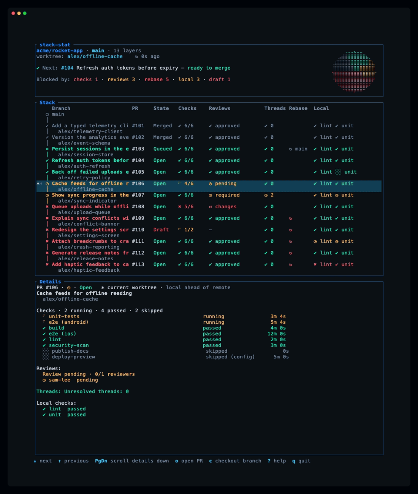

<p align="center">
  
</p>

<p align="center">
  <a href="https://www.rust-lang.org"></a>
  <a href="https://ratatui.rs"></a>
  <a href="https://github.com/cam1se/stack-stat/actions/workflows/ci.yml"></a>
  <a href="https://github.com/cam1se/stack-stat/releases"></a>
</p>

A Rust terminal dashboard for [GitHub stacked PRs](https://github.com/github/gh-stack), single PRs, and branches before PR creation. It answers two questions at a glance: <strong>is each PR ready to merge?</strong> and, if not, <strong>what is blocking it?</strong> It follows the checked-out worktree branch, so it stays accurate while an agent hops between branches.

Open PRs use verdict glyphs: `✔` ready to merge, `◷` still waiting on CI, a review, or a local result, and `✖` blocked. Merged, queued, and closed PRs use separate lifecycle glyphs. The `Next to merge:` header names the next PR and lists its issues, and the detail pane for the selected branch is always open, with failing checks first. A branch with no PR shows local checks and a `no PR yet` hint, not a ready-to-merge PR. Here it is in action:

<p align="center">
  
</p>

## Prerequisites

Install Git and an authenticated [GitHub CLI](https://cli.github.com/):

```sh
gh auth login
```

The dashboard reads stack membership directly from GitHub, so it works without local stack tracking. Install the [`gh stack` extension](https://github.com/github/gh-stack) only to use **stacked** checkout, push, sync, or rebase: `gh extension install github/gh-stack`. These actions ask for confirmation. If stacked push or sync finds no local tracking, a further prompt asks to link the stack through `gh stack checkout` before continuing; declining leaves it unchanged. Opening a PR and toggling draft/ready state need no extension and work for a single PR; without a PR, those actions are unavailable.

## Install and update

> [!NOTE]
> One-time step. Keep it current afterwards with `stack-stat update`.

After a stable release is published, macOS/Linux users can run the checksum-verifying installer:

```sh
bash <(gh api repos/cam1se/stack-stat/contents/scripts/install.sh -H 'Accept: application/vnd.github.raw')
```

Windows users can run [install.ps1](scripts/install.ps1) in PowerShell. `STACK_STAT_VERSION=vX.Y.Z` pins a stable release; `INSTALL_DIR` changes the destination. Both installers verify `checksums.sha256` before installing. Alternatively, build locally with `cargo build --release`; the binary is `target/release/stack-stat`.

`stack-stat version` prints the version and target triple. `stack-stat update` checks GitHub Releases for a newer stable binary, verifies its checksum, and replaces the installed executable. It does not update on its own; the TUI only displays an availability notice. Until the first release exists, `update` exits with `no stable release found`.

## Use

From a Git repository, run `stack-stat`. The tool follows **the current worktree branch** without needing local stack tracking:

- If its selected PR belongs to a GitHub stack, show that stack in GitHub's layer order, with the stack's base branch as trunk. A real stack with one entry still uses stacked mode.
- If the PR has no GitHub stack, show it as a single entry, with its PR base branch as trunk. CI, reviews, draft state, and remote rebase checks work just as they do for a stacked PR.
- If no matching PR exists, show one row for the current branch, with the repository's default branch as trunk. PR-only cells remain empty and a `no PR yet` hint explains the absence; [local checks](#local-checks) still show current, failed, stale, or missing results. This row is not a merge-ready PR.
- If the newest PR for the branch was closed without merging, show it as closed history: never ready to merge and never the next PR to merge.

The default branch itself, without a PR, shows "Default branch" and asks you to check out a feature branch. A detached or empty HEAD shows "No attached branch" and asks you to check out a branch. Startup requires GitHub CLI and authentication, not the stack extension.

In single mode, push runs plain `git push`, while checkout, sync, and rebase are disabled with a status message.

At launch, an animated wordmark and indeterminate loading indicator wait for the first GitHub result before revealing the dashboard. Press any key to skip it; `q` and Ctrl-C still quit immediately.

### Read the dashboard

- **Header:** repository, trunk, and stacked or single mode; the checked-out worktree branch and age of the last GitHub refresh; and, on larger terminals, a pie chart of row statuses beside two lines: `Next to merge:` names the lowest open PR layer by its PR title, or its branch name when the title is empty (stacks merge bottom-up), followed by one bullet per issue, colored red when it blocks and yellow when it is only waiting (or `ready to merge`), and `Blocked by:` counts rows by issue category, including issues that are waiting rather than blocking. A no-PR row is never selected as the next PR to merge. On smaller terminals the header shows nonzero counts for each verdict, including merged, queued, and closed PRs (`⊘`). A spinner means data is being fetched; an overdue refresh is highlighted.
- **Table:** rows hang off the trunk on a git-tree style spine; each PR layer is two lines with its colored verdict glyph as the node. The first line leads with the PR title in bold, then the PR number, state (draft is a PR flag layered over open, alongside merged, queued, and closed), checks, reviews, and local reports; the branch name sits dimmed on the second line. A no-PR row keeps the branch as its headline with a dimmed `no PR yet` hint, without inventing PR cells or a ready-to-merge verdict. The animated, pulsing row is the selected branch shown in the detail pane; `*` in the left column marks the branch checked out in this worktree. A muted suffix reports only that branch's local sync: `↑` has unpushed commits, `↓` has remote commits to incorporate, `⇅` has diverged, and `?` has no remote-tracking branch. Local sync does not change readiness or verdict colors. For a PR, the verdict glyph and headline color answer "is this ready?": `✔` means ready, not a draft, CI passing, no changes requested or review outstanding, no rebase needed, and declared local checks have no failed, stale, or missing result; `◷` means nothing is blocking but evidence is outstanding (running CI, pending review, missing local result); `✖` means a draft, failed CI, requested changes, rebase needed, or a failed or stale local result. Merged and closed layers are dimmed in every column; queued layers are green, and a draft state is red. The Checks cell shows `✔` (green) when everything passed and `✖` (red) when something failed; while any check is queued or running, an animated spinner replaces that icon and keeps the color of the worst state, so it spins yellow normally and red when something has already failed, and the icon returns when the checks finish. It gives passed/total for checks that ran, excluding those skipped by the workflow or by [repository configuration](#configuration). `—` means no result. The Threads column counts unresolved review threads: green `✔ 0` when all are resolved, yellow `◷ N` when some are open, red `✖ N` when open threads are configured to block (see [configuration](#configuration)). The Rebase column appears only when a PR layer needs a rebase: a red `↻` means the layer is blocked because it, or a layer under it, must be rebased (the detail pane names which; a rebase moves every layer above it, so each of them is marked), and `↻ <trunk>`, for example `↻ main`, means the first unmerged layer is behind the trunk (gray unless `rebase.onto_trunk` makes it blocking). The Local column appears only when local checks are declared or reported for the view. The Reviews cell is red for changes requested, yellow when GitHub requires a review that is still outstanding (`required` when nobody has been asked, `pending` when someone has), and green when approved; when reviews are not required it stays gray and does not block the ready verdict.
- **Detail pane:** always open for the selected branch and starts on the worktree's checked-out branch. Its header names that branch's local sync next to `current worktree`, then shows the PR title in bold with the branch name dimmed beneath it (a branch without a PR title keeps the branch name as the headline); checks are listed failing first, then running, passed, and skipped, with durations; reviews show a headline and each visible reviewer, then local reports and whether the branch needs a rebase. When the details are longer than the pane, a scrollbar on its right edge shows the position; scroll with Page Up/Down or the mouse wheel.
- **Footer:** key hints and operation results. Actions that change GitHub or the worktree open a confirmation modal listing the exact commands; press `Enter` or `y` to run them, `Esc` or `n` to cancel. Opening a PR in the browser runs immediately.

| Key or mouse gesture | Effect |
|---|---|
| ↑/↓, Home/End | Select next/previous or first/last row |
| Page Down/Up | Scroll the detail pane by page; branch selection stays put |
| Wheel over table / detail | Move selected branch / scroll detail lines |
| Click a table row | Select that branch |
| `o` | Open the selected PR in a browser; unavailable without a PR |
| `c` | Confirm stacked checkout; disabled in single mode |
| `p` | Confirm push: `gh stack push` in stacked mode, plain `git push` in single mode |
| `S` | Confirm stacked sync (`gh stack sync`: fetch, rebase, push); disabled in single mode |
| `R` | Confirm stacked rebase (`gh stack rebase`: rewrites local history, pushes nothing); disabled in single mode |
| `d` | Confirm draft/ready toggle; unavailable without a PR |
| `r` | Refresh all data sources |
| `/`, `t`, `b` | Filter branches, cycle sort order, show/hide bot reviews |
| `?`, `q` or Esc, Ctrl-C | Help, quit (Esc first dismisses a persistent error message) |

The in-app `?` overlay is the source of truth for keybindings. Shifted letters mark operations that rewrite history; lowercase keys are safe or reversible. In filter mode, type a branch substring, press Enter to keep it, or Esc to clear it. `t` cycles stack order, ascending PR number, and worst-check-first status order. Git and local results refresh frequently; GitHub refreshes more often while CI is active. Network failures preserve the last successful GitHub data.

## Configuration

No configuration file is required. The repository file `.stack-stat.toml` lives at the current worktree root. It declares which GitHub checks matter in the display, which local checks are expected, and bot reviewer names.

```toml
[checks.skip]
names = ["secrets-scan"]
patterns = ["codecov/*"]

[checks.local]
lint = { description = "cargo clippy --workspace --all-targets --locked -- -D warnings" }
test = { description = "cargo test --workspace --locked --no-fail-fast" }

[reviews]
bots = ["ci-bot"]
show_bots = false
gate_on_unresolved_threads = false

[rebase]
onto_trunk = false

[poll]
git = 2
store = 2
github = 30
github_active = 15
```

`checks.skip.names` matches exact GitHub check names; `patterns` matches the **whole** name, with `*` for any span and `?` for one character. Excluded checks remain visible in the detail pane as "skipped (config)" but do not count toward passed/total. `checks.local` names expected manual reports; each description is display text, **not a command the TUI executes**. Missing and stale results remain visible until agents or scripts report a result for the current commit. `reviews.gate_on_unresolved_threads` (default `false`) decides whether unresolved review threads block the ready verdict: when `true`, any unresolved thread makes the layer blocked (`✖`); when `false`, the Threads column still shows the count in yellow but the verdict ignores it. Only the first unmerged layer is checked against the trunk when `rebase.onto_trunk` is enabled; later layers are checked against the layer below them. A blocking rebase also blocks every layer above it in the stack.

The poll values are positive whole seconds. Defaults: local Git and store every 2 seconds, GitHub every 30 seconds while idle and 15 seconds while checks are queued or running. `r` requests an immediate refresh. GitHub rate limiting temporarily suspends remote polling but local data continues. No animation toggle is needed; animations are always enabled.

### Personal display preferences

Place user-only settings at `$XDG_CONFIG_HOME/stack-stat/config.toml` when `XDG_CONFIG_HOME` is set, at `%APPDATA%\stack-stat\config.toml` on Windows otherwise, or `~/.config/stack-stat/config.toml` on Unix otherwise:

```toml
[poll]
github = 60

[display]
reviews_default = "expanded"
```

`reviews_default` is `collapsed` (default) or `expanded` (per-reviewer inline on wide terminals). The detail pane always shows individual visible reviewers. Personal `[poll]` values override repository poll values. Repository `[checks.*]` and bot settings are authoritative: user attempts to set them are ignored with a warning, not used to un-skip CI or alter declared checks. Unknown keys, malformed TOML, or zero-second intervals fail configuration loading with a path or key diagnostic. Fix the file before reopening the TUI.

## Local checks

`stack-stat report` records `pass`, `fail`, or `skip` for the branch and commit an agent actually tested, so the dashboard shows lint and test results next to CI. Results are stored as JSON under Git's common directory and are visible from the repository's other worktrees. If the branch tip changes, the earlier outcome is marked stale rather than presented as a fresh pass. Writes replace the result atomically, so readers never see a partial file.

```sh
stack-stat report lint pass --message 'clippy clean'
stack-stat report test fail --branch feat/api --sha HEAD~1 --message 'three assertions failed'
stack-stat report --list
stack-stat report --list --json
stack-stat report --clear --branch feat/api
```

Use `--branch` and `--sha` when an agent moves between branches before recording a result. `--sha` accepts any revision Git resolves to a commit. When only `--branch` is supplied, the report applies to that branch's current tip; without either flag, the current worktree branch and its tip are used. A detached HEAD needs an explicit branch. `--list --json` includes a `stale` flag so tools can distinguish old evidence.

A repository can declare expected checks under `[checks.local]` in `.stack-stat.toml`. Reporting an undeclared name is accepted but prints a note. The dashboard shows declared checks without a result as missing. The description in `[checks.local]` is display text only; stack-stat never runs the command. The store keeps the current commit's results plus the most recent older result for stale context; earlier files and deleted branches are cleaned up during polling.

## Troubleshooting

### The dashboard does not open

| Message | Action |
|---|---|
| `gh CLI not found` | Install [GitHub CLI](https://cli.github.com/) and check `gh --version`. |
| `gh not authenticated` | Run `gh auth login`, then `gh auth status`. |
| `not in a git repository` | Run from a worktree; `git rev-parse --show-toplevel` should print its root. |

`stack-stat version` does not need a repository or GitHub login. `stack-stat report` needs Git but does not need GitHub authentication. The dashboard needs authenticated `gh`, but neither reading stacked or single-mode data nor reporting checks requires the `gh stack` extension.

### Single PR or "no PR yet"

The TUI follows the **checked-out worktree branch** and reads its PR's stack from GitHub, not local `gh stack` tracking. A PR with a non-null GitHub stack uses stacked mode even when the stack has only one entry, and a fresh clone or worktree can read that stack without initializing or linking it locally. An unstacked PR appears as one entry with the PR's base branch as trunk and the usual CI, review, draft, and remote rebase details. A branch without a matching PR appears as one row with the repository's default branch as trunk, empty PR-only cells, and a `no PR yet` hint. Local checks still apply, including missing or stale reports; passing local checks do not make the branch a ready-to-merge PR or a `Next to merge` candidate. Open a PR when you want PR details; there is no need to create a stack just to use the dashboard. A PR closed without merging is shown as closed history and cannot be marked draft or ready.

Checkout (`c`), sync (`S`), and rebase (`R`) are disabled in single mode and report that status without running a stack command. Push (`p`) uses plain `git push` after confirmation and needs no extension or local stack tracking. The status bar shows the line explaining the failure, such as a `[rejected]` non-fast-forward push or a missing upstream. If Git reports no upstream or another push configuration error, inspect the configured remote and branch in a terminal and set the upstream explicitly, for example with `git push --set-upstream <remote> <branch>`. stack-stat does not choose an upstream or link a stack for you. Browser opening (`o`) and draft/ready toggling (`d`) work when a PR exists; they are unavailable on a no-PR row.

If you switch branches outside the dashboard, push, checkout, sync, and rebase wait for the next GitHub result instead of acting on the previous branch's mode; the status bar reports the refresh, and the key works again once it completes.

### "No attached branch" or "Default branch"

A detached or empty HEAD shows "No attached branch" because there is no current branch to display. Check out a branch to use the dashboard. The repository's default branch without its own PR shows "Default branch", because there is nothing to compare it against; check out a feature branch to see its row.

### Data looks old or incomplete

The footer shows fetch failures; the last successful GitHub data remains visible during a network outage. `r` requests refresh. GitHub rate limiting pauses remote requests until the reset time (or the retry fallback) while local Git and check reports keep refreshing. If authentication expires, run `gh auth login` again. A PR number with no draft/check/review details may be inaccessible or deleted; the stack still supplies its identity.

Local checks apply to a commit SHA, not merely a branch name. If a report is **stale**, run the check again on the branch's current commit and issue a fresh [`stack-stat report`](#local-checks). An expected check marked **missing** has not been reported for this commit. A malformed local JSON file is skipped with a warning rather than hiding other reports. Reporting that check again for the same commit replaces the damaged file; `stack-stat report --clear --branch <name>` removes all entries for that branch.

The muted suffix beside the `*` worktree marker is local sync information only: `↑` means commits have not been pushed, `↓` means the remote-tracking ref has commits to incorporate, `⇅` means both sides have unique commits, and `?` means no upstream or `origin/<branch>` ref exists. It does not affect the layer verdict. Push, fetch, rebase, or configure an upstream as appropriate.

### Mutations and rebase conflicts

Available mutations open a confirmation modal; press `Enter` or `y` to accept and `Esc` or `n` to cancel. Only one operation runs at once. In stacked mode, a `gh stack` conflict leaves the TUI open and reports the error; resolve it with `gh stack rebase --continue` or `gh stack rebase --abort` in a terminal after inspecting the repository state. A sync that prints `Sync aborted` despite exiting 0 means local and remote stack chains diverge; stack-stat treats it as an abort, not as a successful sync. Inspect the two chains before retrying. stack-stat never silently resolves conflicts.

If stacked checkout, push, sync, or rebase reports that `gh stack` is unavailable, run `gh extension install github/gh-stack` and verify with `gh extension list`. The extension is needed only for these stacked actions; its absence does not prevent the dashboard from opening or a single-mode push from running.

Stacked push, sync, and rebase need local stack tracking. When it is missing, stack-stat asks for confirmation before running `gh stack checkout <pr-number-or-branch>` to link it, then continues the requested action. Checkout can change the worktree, so inspect the target in the prompt. Declining does not link or retry and leaves a cancellation message. No read or refresh links a stack automatically.

### Releases and terminal display

Before the first stable release, `stack-stat update` exits with `no stable release found`. The version check inside the TUI is background-only and does not prevent startup. If colors look wrong, set `COLORTERM=truecolor` in a capable terminal or let `TERM` select a 256-color palette; basic 16-color terminals still show verdict glyphs and a bold pulse on the selected row. If the terminal becomes narrow, review and local columns collapse; resize to see full names. Overflowing details scroll with Page Up/Down or the mouse wheel over the pane.

## Contributing

Developers should read [AGENTS.md](AGENTS.md), the [contributor guide](CONTRIBUTING.md), and the [architecture overview](docs/architecture/01-l1-context.md).
