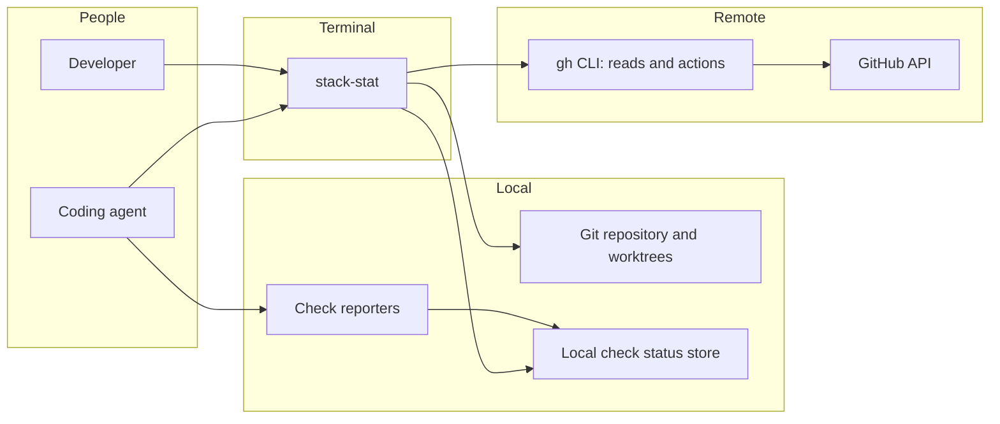

# 01 — System context

stack-stat presents the current repository's stacked pull requests to a developer or coding agent in a terminal. It reads local Git for the checked-out branch and uses the authenticated `gh` CLI to retrieve stack and PR state from GitHub. The `gh stack` extension handles checkout, push, and sync actions only. Agents, hooks, and scripts report local checks into a repository-local store shared across worktrees.

GitHub is the authority on stack membership and layer order; no local stack tracking is required to read them. The dashboard follows the worktree's checked-out branch. When that branch has no PR or its PR has no GitHub stack, it displays a not-in-stack view rather than guessing a stack. The separation between reads and `gh stack` actions is recorded in [ADR-0002](../adr/0002-read-stack-from-github.md).

See [container boundaries](02-l2-containers.md) for binary and library responsibilities and [the terminal application](06-tui.md) for interaction behavior.
