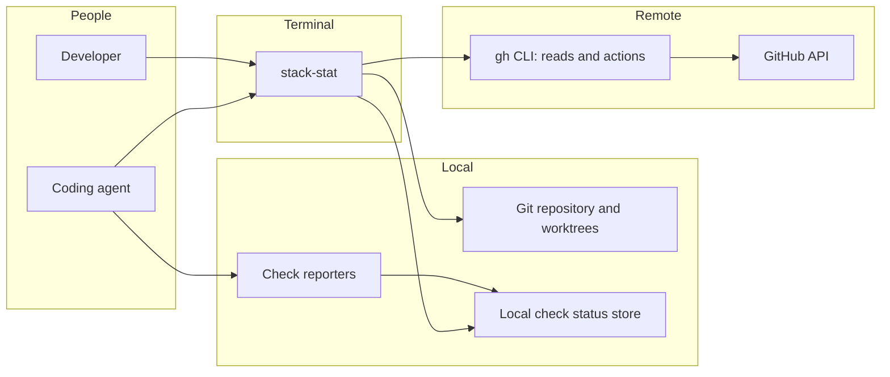

# 01 — System context

stack-stat presents the current repository's stacked or single pull requests, and local checks before PR creation, to a developer or coding agent in a terminal. It reads local Git for the checked-out branch and uses the authenticated `gh` CLI to retrieve stack and PR state from GitHub. The `gh stack` extension handles stacked checkout, push, and sync actions only; single-mode push uses Git directly. Agents, hooks, and scripts report local checks into a repository-local store shared across worktrees.

GitHub is the authority on stack membership and layer order; no local stack tracking is required to read them. The dashboard follows the worktree's checked-out branch. A branch whose PR has no GitHub stack, or which has no matching PR, uses a single-mode view rather than inferred stack membership. [Provider normalization](05-providers-and-store.md#github-adapter) defines its rows and trunk. The read/action split is recorded in [ADR-0002](../adr/0002-read-stack-from-github.md); [ADR-0003](../adr/0003-single-pr-and-no-pr-mode.md) supersedes its single-mode missing-data and action rules.

See [container boundaries](02-l2-containers.md) for binary and library responsibilities and [the terminal application](06-tui.md) for interaction behavior.
