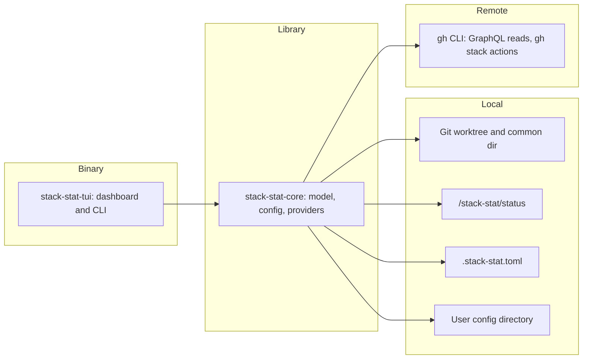

# 02 — Containers and data

The Cargo workspace has a reusable domain library and a terminal binary. The binary's default command renders the dashboard; its `report` command writes check results and its `update` command updates installed releases.

The library owns the provider contracts so the dashboard can be exercised with fake git, GitHub, and status-store providers. The store lives under Git's common directory to keep results shared among worktrees and out of tracked files. Per-repository configuration stays at the worktree root; user display preferences stay in the platform config directory.

Read [system context](01-l1-context.md) for actors, [providers and store](05-providers-and-store.md) for external boundaries, and [the terminal application](06-tui.md) for interaction behavior.
