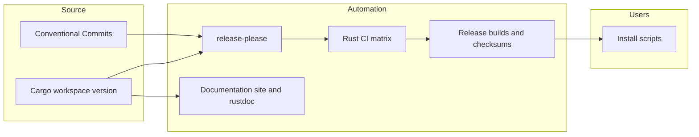

# 03 — Distribution

The Cargo workspace version in the [manifest](../../Cargo.toml) is the version source. Conventional Commit subjects follow the types and scopes in [`.gitmessage`](../../.gitmessage); [commit lint](../../scripts/commit-lint.sh) applies that policy. Release-please manages version-bump PRs and tags. The release workflow tests and packages the `stack-stat` binary for macOS, Linux, and Windows. [Installation scripts](../../scripts/) download an archive from GitHub Releases and verify its SHA-256 checksum before placing a binary on PATH.

The asset contract is `stack-stat-<version>-<target>.tar.gz` on Unix and `.zip` on Windows, accompanied by `checksums.sha256`. An archive contains a directory with the same stem, the binary, LICENSE, and README. The self-update command will use this exact naming, so archive names and installer lookups must change together.

The release-please workflow uses the repository-scoped `GH_ACCESS_TOKEN` Actions secret so tag pushes trigger the release workflow. The [contributor guide](../../CONTRIBUTING.md) describes permission and rotation requirements. [System context](01-l1-context.md) and [containers](02-l2-containers.md) cover runtime architecture, not packaging.
