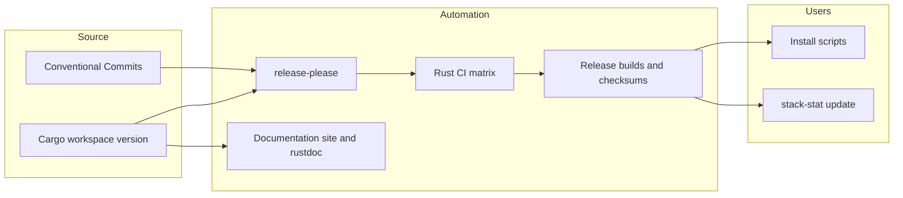

# 03 — Distribution

The Cargo workspace version in the [manifest](../../Cargo.toml) is the version source. Conventional Commit subjects follow the types and scopes in [`.gitmessage`](../../.gitmessage); [commit lint](../../scripts/commit-lint.sh) applies that policy. Release-please manages version-bump PRs and tags. The release workflow tests and packages the `stack-stat` binary for macOS, Linux, and Windows. [Installation scripts](../../scripts/) download an archive from GitHub Releases and verify its SHA-256 checksum before placing a binary on PATH.

The asset contract is `stack-stat-<version>-<target>.tar.gz` on Unix and `.zip` on Windows, accompanied by `checksums.sha256`. An archive contains a directory with the same stem, the binary, LICENSE, and README. Both installers and the `stack-stat update` command use this exact naming, so archive names and lookups must change together.

The release-please workflow uses the repository-scoped `GH_ACCESS_TOKEN` Actions secret so tag pushes trigger the release workflow. The [contributor guide](../../CONTRIBUTING.md) describes permission and rotation requirements. [System context](01-l1-context.md) and [containers](02-l2-containers.md) cover runtime architecture, not packaging.

## Self-update

The compiled target triple and workspace version identify the expected release asset. `stack-stat update` queries stable, non-draft `vX.Y.Z` releases through `gh`, compares versions numerically, and downloads only when newer. It verifies the archive against `checksums.sha256` before extracting only the expected executable to a temporary directory; other archive members cannot write outside that directory. Checksum or extraction failure aborts before replacement. `self-replace` performs the replacement, including on Windows where an executable cannot be overwritten in place; a replacement error is reported to the caller.

The TUI checks for a newer release once in a background task after drawing its first frame. Failures are debug-only and do not interrupt stack status. The footer advertises a newer version but never installs it without a user running `stack-stat update`.
