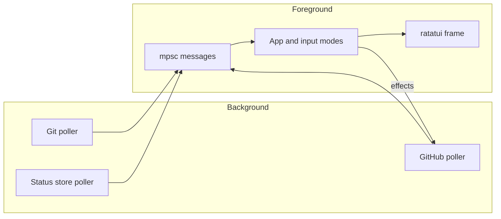

# 06 — Terminal application

The default binary command checks for authenticated `gh` before entering raw terminal mode; the `gh stack` extension is required only when executing stacked checkout, push, or sync. The [core providers](05-providers-and-store.md) supply Git, GitHub, and local check snapshots, including explicit stacked or single mode. The App owns the most recent successful slice of each source; its pure [compositor](04-domain-and-config.md) creates the view used by rendering.

## Messages and input modes

The main loop selects terminal input, provider messages, and a presentation tick. Provider errors retain the last successful snapshot, except an explicit `NotInStack` result, which clears rows for a detached or empty HEAD. A successful single-mode result replaces earlier stack rows with the current PR or no-PR branch; leaving a stack does not itself clear the dashboard. Fetch errors are tracked per source, so a successful local poll does not erase an outstanding GitHub warning; failed one-off mutations are transient and never suppress later fetch errors. A confirmation prompt remains visible during unrelated polls, and opening a PR does not release the busy guard on a concurrent push. A change of the checked-out branch updates the worktree marker and its local-to-remote suffix on the next Git poll. The App exposes narrow input, snapshot, effect, and tick methods that tests can drive with fake providers and an injected timestamp; no test needs a terminal or wall-clock sleep.

The keymap is one table shared by input dispatch and the help overlay. Normal mode handles navigation and actions. Filter mode edits a branch-name query. Help consumes its next key without navigating. Mutations use a confirmation mode that accepts only `y`; another key cancels. Only one mutation can be in flight. Effects run outside the key handler, then request an immediate refresh on completion. Terminal raw mode, alternate screen, and cursor state are restored on normal exit, errors, and panic.

If a confirmed stacked push or sync discovers missing local stack tracking, the App asks separately before linking it through `gh stack checkout` and continuing the original action. Declining performs no checkout or retry and reports cancellation. Reading stack membership never initializes or links a local stack; see [ADR-0002](../adr/0002-read-stack-from-github.md).

In single mode, a confirmed push uses plain `git push`; upstream errors are reported without a stack-link prompt. Checkout and sync instead report that the action is unavailable in single mode and launch no mutation. Browser opening and draft/ready toggling remain available for a single PR; a row with no PR cannot perform either PR action, and a closed PR cannot toggle draft state. Mode comes from provider metadata, not row count, so a genuine one-entry stack retains stacked actions. Because that metadata arrives with the GitHub snapshot, push, checkout, and sync refuse to run and request a refresh while the snapshot was discovered for a different branch than the current worktree branch. [ADR-0003](../adr/0003-single-pr-and-no-pr-mode.md) records these narrower missing-data and action rules.

## Frame layout and theme

At widths below 100 columns, reviews collapse to an icon; below 80, local checks collapse to a worst-state icon. Branch names truncate before fixed status columns shrink. Status glyphs are single-width Unicode symbols, never emoji, because emoji widths vary by terminal and misalign columns. The current worktree marker has a muted suffix for local sync (`↑` ahead, `↓` behind, `⇅` diverged, `?` unpushed); it never changes a layer verdict or row color. The renderer reads only App state and its injected clock value. Pane borders use a calm shade of the logo blue, pane titles the logo blue, and keys in the footer plus identifying values in the header (trunk, worktree branch, PR numbers) use the logo cyan; status colors stay reserved for state. Theme selection happens once on launch: `COLORTERM` selects truecolor when available, `TERM` falls back to indexed colors, and basic ANSI colors remain usable otherwise.

The header labels the next open PR candidate `Next to merge:`. A no-PR branch is not eligible for that selection and is never presented as a ready-to-merge PR. Its row and detail pane show a `no PR yet` hint rather than fabricated PR identity, lifecycle, checks, or reviews; commit-specific local checks still show their normal failed, stale, and missing states. [Provider normalization](05-providers-and-store.md#github-adapter) defines trunk selection for stacked, single-PR, and no-PR views.

## Animation model

The App owns a monotonic presentation tick advanced every 100 ms. A 20-tick sine wave pulses the selected row; basic 16-color terminals pulse by toggling bold instead of changing the background. Queued and running checks use a braille spinner in both table and detail. When a successful provider update changes visible check, review, state, worktree marker, PR, or local-result cells, those cells flash for five ticks. Unchanged polls do not retrigger flashes. Loading placeholders shimmer by column, the header spins while a fetch is in flight, and stale GitHub age pulses after twice the active polling interval. Rendering computes these effects from App state and the injected time; it never reads the wall clock itself.

Startup is runtime-owned rather than App-owned: before the first GitHub outcome (success, off-stack, or error), it overlays a centered block-letter wordmark. `tachyonfx` coalesces the logo from a deterministic noise field, then keeps a contained shimmer/sweep alive beside the indeterminate loading indicator while the pure dashboard renderer remains covered. On the first outcome, the overlay dissolves as the header and pie fade/sweep in and lower stack rows arrive before upper rows. The runtime supplies effect deltas, draws at roughly 30 fps only while the intro owns the frame, completes the reveal within 1.05 seconds, then drops the intro and returns to the App's existing 100 ms cadence. Basic 16-color terminals use a no-RGB fallback. Confining `tachyonfx` to this runtime-owned startup overlay leaves the App's deterministic tick effects unchanged.

## Refresh policy

Git and the local store poll independently at their configured intervals. GitHub polls more often while checks are running or queued, and pauses after a rate-limit error until a parseable reset or the fallback delay. A forced refresh wakes pollers without waiting for their normal timers. Store cleanup waits for an initial Git branch map so it does not delete reports before learning which branches exist.

## Extending a keybinding

Add the semantic action and one entry to [the keymap](../../crates/stack-stat-tui/src/action.rs), handle it in the appropriate App input mode, and cover its observable state/effect in [behavioral tests](../../crates/stack-stat-tui/tests/app_state.rs). For layout changes, add [TestBackend assertions](../../crates/stack-stat-tui/tests/render.rs) when rendering ships.
