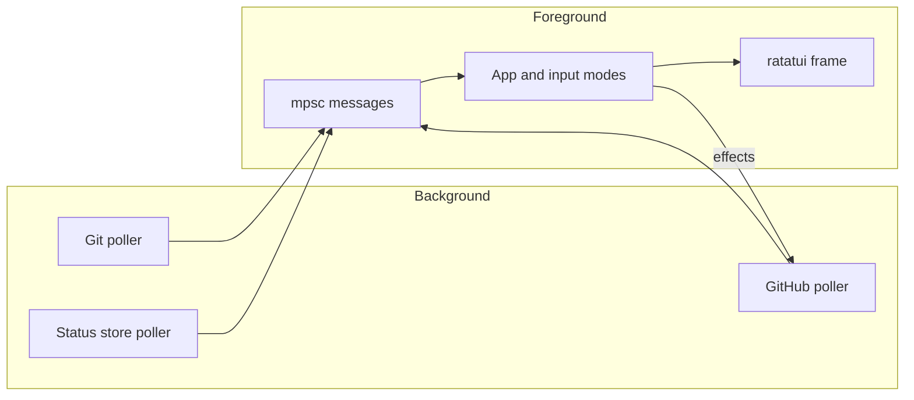

# 06 — Terminal application

The default binary command checks for authenticated `gh` and the `gh stack` extension before entering raw terminal mode. The [core providers](05-providers-and-store.md) supply Git, GitHub, and local check snapshots. The App owns the most recent successful slice of each source; its pure [compositor](04-domain-and-config.md) creates the view used by rendering.

## Messages and input modes

The main loop selects terminal input, provider messages, and a presentation tick. Provider errors retain the last successful snapshot, except an explicit `NotInStack` result, which clears rows as the worktree leaves its stack. Fetch errors are tracked per source, so a successful local poll does not erase an outstanding GitHub warning; failed one-off mutations are transient and never suppress later fetch errors. A confirmation prompt remains visible during unrelated polls, and opening a PR does not release the busy guard on a concurrent push. A change of the checked-out branch updates the worktree marker on the next Git poll. The App exposes narrow input, snapshot, effect, and tick methods that tests can drive with fake providers and an injected timestamp; no test needs a terminal or wall-clock sleep.

The keymap is one table shared by input dispatch and the help overlay. Normal mode handles navigation and actions. Filter mode edits a branch-name query. Help consumes its next key without navigating. Mutations use a confirmation mode that accepts only `y`; another key cancels. Only one mutation can be in flight. Effects run outside the key handler, then request an immediate refresh on completion. Terminal raw mode, alternate screen, and cursor state are restored on normal exit, errors, and panic.

## Frame layout and theme

The header reserves separate lines for stack order, the worktree branch, and a per-verdict summary so the branch remains visible when a chain is too wide. The body is a status table of two-line rows hung on a git-tree spine from the trunk (each node is the layer's verdict glyph in its verdict color, joined by a vertical line): branch, PR identity, lifecycle, a filtered CI summary, visible review state, and reported local checks, then the PR title. Branch verdicts come from the core `BranchState::verdict`, which treats unknown evidence as not ready; presentation lives in one shared module so rows, header, and details agree, and state is distinguishable by glyph without color. The checked-out branch and selected row are distinct: `←wt` marks the former and `►` marks the latter. A detail pane for the selected branch is always shown, takes all vertical space the table does not need (the table is capped at half the body and scrolls), and lists checks failing first, then running, skipped, and passed, plus reviewers, local results, and rebase warnings. Initial selection is the worktree's branch. `j/k` and the mouse wheel over the table move the selected branch; `J/K` and Page Up/Down scroll detail lines without changing selection. The mouse wheel scrolls whichever pane it hovers, and clicking a table row selects it. No focus-navigation mode is needed. Overflowing details show a continuation marker until scrolled to the end. The footer provides context-sensitive key hints, confirmations, fetch errors, and update notices. Help is generated from the same keymap used for dispatch and uses two columns on shorter terminals.

At widths below 100 columns, reviews collapse to an icon; below 80, local checks collapse to a worst-state icon. Branch names truncate before fixed status columns shrink. Status glyphs are single-width Unicode symbols, never emoji, because emoji widths vary by terminal and misalign columns. The renderer reads only App state and its injected clock value. Theme selection happens once on launch: `COLORTERM` selects truecolor when available, `TERM` falls back to indexed colors, and basic ANSI colors remain usable otherwise.

## Animation model

The App owns a monotonic presentation tick advanced every 100 ms. A 20-tick sine wave pulses the checked-out branch, including when it is also selected; basic 16-color terminals pulse by toggling bold instead of changing the background. Queued and running checks use a braille spinner in both table and detail. When a successful provider update changes visible check, review, state, branch, PR, or local-result cells, those cells flash for five ticks. Unchanged polls do not retrigger flashes. Loading placeholders shimmer by column, the header spins while a fetch is in flight, and stale GitHub age pulses after twice the active polling interval. Rendering computes these effects from App state and the injected time; it never reads the wall clock itself.

## Refresh policy

Git and the local store poll independently at their configured intervals. GitHub polls more often while checks are running or queued, and pauses after a rate-limit error until a parseable reset or the fallback delay. A forced refresh wakes pollers without waiting for their normal timers. Store cleanup waits for an initial Git branch map so it does not delete reports before learning which branches exist.

## Extending a keybinding

Add the semantic action and one entry to [the keymap](../../crates/stack-stat-tui/src/action.rs), handle it in the appropriate App input mode, and cover its observable state/effect in [behavioral tests](../../crates/stack-stat-tui/tests/app_state.rs). Help uses the same keymap; it does not need a second manually maintained list. For layout changes, add [TestBackend](../../crates/stack-stat-tui/tests/) assertions when rendering ships.
