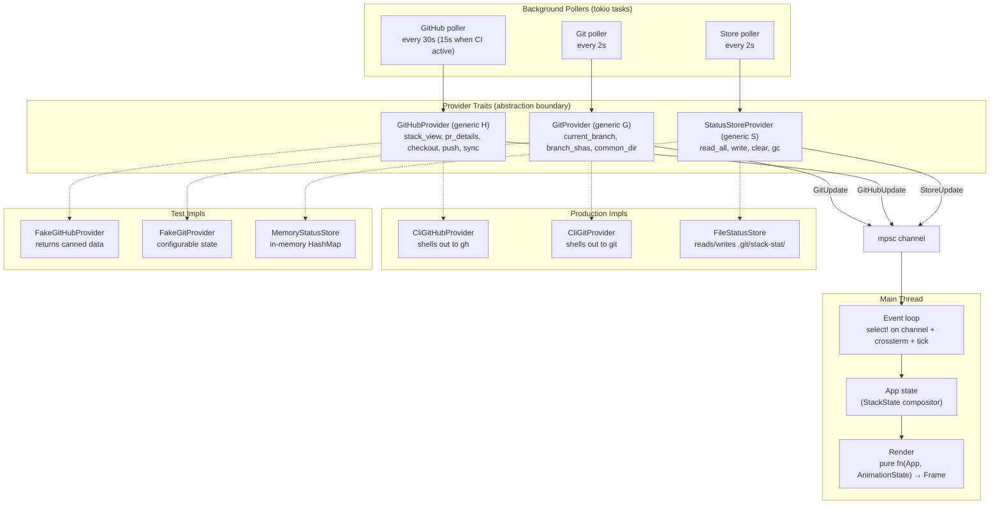

# 001 — stack-stat TUI Design

A terminal dashboard for GitHub stacked PRs. Shows stack structure, PR state,
CI checks, review status, and local check results in a live-updating TUI.
Built on `gh stack` and the GitHub CLI.

## Goals

1. **At-a-glance stack health** — see every layer's PR state, CI, reviews, and
   local checks in one view without leaving the terminal.
2. **Agent-aware** — highlight which branch the worktree currently has checked
   out, updating live as an agent switches branches.
3. **Actionable** — open PRs in browser, checkout branches, push, sync, and
   toggle draft/ready without leaving the TUI.
4. **Local check integration** — external tools (agents, hooks, scripts) report
   check results via a CLI; the TUI displays them alongside GitHub checks.
5. **Per-repo configuration** — filter noisy CI checks, declare expected local
   checks, label bot reviewers.
6. **Self-updating** — ships as a single binary with install scripts and a
   built-in update command.

## Non-goals

- Replacing `gh stack` commands — stack-stat shells out to `gh stack` and `gh`,
  it does not reimplement their logic.
- Multi-repo aggregation — operates on the current repo only.
- Webhook/server mode — no listening endpoint; all data is polled.

---

## Architecture



### Crate structure

```
stack-stat/
  Cargo.toml                        # workspace root
  crates/
    stack-stat-core/                 # Library: domain model, config, provider traits + impls
      src/
        lib.rs
        model.rs                     # StackState, Branch, PrInfo, CheckResult, ReviewInfo
        compose.rs                   # Pure compositor: snapshots + config → StackState
        config.rs                    # .stack-stat.toml + ~/.config/stack-stat/config.toml
        providers/
          mod.rs                     # Trait definitions: GitProvider, GitHubProvider, StatusStoreProvider
          git_cli.rs                 # CliGitProvider — shells out to git
          github_cli.rs             # CliGitHubProvider — shells out to gh, parses JSON
          file_store.rs             # FileStatusStore — reads/writes .git/stack-stat/status/
          fake_git.rs               # FakeGitProvider — configurable test state (cfg(test))
          fake_github.rs            # FakeGitHubProvider — canned responses (cfg(test))
          memory_store.rs           # MemoryStatusStore — in-memory HashMap (cfg(test))
    stack-stat-tui/                  # Binary: terminal UI + report subcommand
      src/
        main.rs                      # Startup checks, clap subcommands, tokio runtime
        app.rs                       # App<G, H, S> state, event loop, message dispatch
        poll.rs                      # Background pollers → channel producers (generic over providers)
        action.rs                    # Keybinding → Action enum dispatch
        theme.rs                     # Color palette, 16/256/truecolor detection
        update.rs                    # Self-update via gh release
        ui/
          mod.rs
          header.rs                  # Stack chain + worktree indicator + refresh age
          table.rs                   # Branch table with status columns
          detail.rs                  # Expandable per-PR detail pane
          status_bar.rs              # Errors, keybinding hints, update notification
          help.rs                    # ? overlay with full keybinding reference
          animation.rs              # AnimationState, tick logic, color interpolation
```

**`stack-stat-core`** is a library crate with no TUI dependencies. It defines
the provider traits (`GitProvider`, `GitHubProvider`, `StatusStoreProvider`)
and ships both production CLI-backed implementations and `#[cfg(test)]` fake
implementations. The `report` subcommand uses it for store writes without
pulling in ratatui/crossterm. `stack-stat-tui` depends on core and is generic
over the provider traits — `App<G: GitProvider, H: GitHubProvider, S: StatusStoreProvider>` — so E2E tests can inject fakes.

### Binary subcommands

```
stack-stat                          # launch TUI (default)
stack-stat report <check> <state>   # write local check result
stack-stat update                   # self-update from GitHub Releases
stack-stat version                  # print version
```

---

## Data Model

### `StackState` — the unified view

The compositor merges data from all sources into a single `StackState`. Each
source populates its slice; missing slices are `None` (loading) or stale.

```rust
struct StackState {
    trunk: String,                      // e.g. "main"
    branches: Vec<BranchState>,         // stack order, trunk-first
    worktree_branch: String,            // current HEAD of the worktree
    last_git_fetch: Option<DateTime<Utc>>,    // from snapshot fetched_at (compositor stays clock-free)
    last_github_fetch: Option<DateTime<Utc>>,
    last_store_fetch: Option<DateTime<Utc>>,
}

struct BranchState {
    name: String,
    head_sha: String,                   // from git
    needs_rebase: bool,                 // from gh stack view
    is_current: bool,                   // name == worktree_branch
    pr: Option<PrInfo>,                 // from gh api graphql (pr_details)
    local_checks: Vec<LocalCheckResult>,// from status store
}

struct PrInfo {
    number: u32,
    url: String,
    is_draft: bool,
    review_decision: ReviewDecision,    // APPROVED, CHANGES_REQUESTED, REVIEW_REQUIRED
    checks: Vec<CiCheck>,
    reviews: Vec<Review>,
}

enum ReviewDecision { Approved, ChangesRequested, ReviewRequired, None }

struct CiCheck {
    name: String,
    workflow: String,
    status: CheckStatus,               // Queued, InProgress, Completed
    conclusion: Option<CheckConclusion>,// Success, Failure, Skipped, ...
    started_at: Option<DateTime>,
    completed_at: Option<DateTime>,
    details_url: String,
    skipped_by_config: bool,            // filtered by .stack-stat.toml
}

struct Review {
    author: String,
    state: ReviewState,                 // Approved, ChangesRequested, Commented, Dismissed, Pending
    is_bot: bool,                       // GraphQL author __typename == "Bot", or login listed in config [reviews].bots
}

struct LocalCheckResult {
    name: String,
    state: LocalCheckState,             // Pass, Fail, Skip, Missing (declared in config, never reported)
    sha: String,                        // SHA when check was run
    is_stale: bool,                     // sha != branch HEAD
    message: Option<String>,
    recorded_at: DateTime,
}
```

### Data source mapping

| Field | Source | Command |
|-------|--------|---------|
| `trunk`, branch order, `needs_rebase`, PR number/url | `gh stack view --json` | One call |
| `is_draft`, `review_decision`, `checks`, `reviews`, pending reviewers | `gh api graphql` with one aliased `pullRequest(number: N)` selection per PR number from `stack_view` (fields: `isDraft`, `reviewDecision`, `latestReviews`, `reviewRequests`, last commit `statusCheckRollup.contexts`) | One call for all PRs |
| `worktree_branch`, `head_sha` | `git symbolic-ref HEAD`, `git rev-parse <branch>` | Local |
| `local_checks` | `.git/stack-stat/status/<branch>/<sha>.json` | File read |

Key insight: one aliased GraphQL query fetches every stack PR's details by
number. That is exact (no `--limit` truncation or open-only filtering as with
`gh pr list`) and needs no per-PR calls. Repo owner/name are resolved once at
startup via `gh repo view --json owner,name`. Total GitHub API calls per
refresh cycle: 2 (`gh stack view` + one `gh api graphql`). Pending reviewers
come from `reviewRequests` (requested, not yet reviewed) and render as
`ReviewState::Pending`.

### Provider traits (abstraction boundary)

All external data access goes through three traits defined in
`stack-stat-core::providers`. The pollers, compositor, and action handlers are
generic over these traits. Production wires in CLI-backed implementations;
tests wire in fakes.

```rust
/// Git repository state. Implemented by CliGitProvider (production)
/// and FakeGitProvider (test).
#[async_trait]
pub trait GitProvider: Send + Sync {
    /// The branch name HEAD points to (e.g. "auth").
    async fn current_branch(&self) -> Result<String>;
    /// Map of branch name → full commit SHA for all local branches.
    async fn branch_shas(&self) -> Result<HashMap<String, String>>;
    /// Resolve the git common dir (for status store path).
    fn common_dir(&self) -> &Path;
}

/// GitHub stack and PR state. Implemented by CliGitHubProvider (production)
/// and FakeGitHubProvider (test).
/// All methods return `Result<T, GitHubError>` (typed: NotInStack,
/// RebaseConflict, RateLimited, Auth, Network, Command, Parse) so callers can
/// branch on the failure kind.
#[async_trait]
pub trait GitHubProvider: Send + Sync {
    /// Stack structure: trunk, branch order, needs_rebase, PR number/url.
    /// Wraps `gh stack view --json`.
    async fn stack_view(&self) -> Result<StackViewResponse>;
    /// PR details for the given PR numbers: draft, checks, reviews, pending
    /// review requests. Wraps one aliased `gh api graphql` query.
    async fn pr_details(&self, numbers: &[u32]) -> Result<Vec<PrResponse>>;
    /// Open a PR in the default browser. Wraps `gh pr view --web`.
    async fn open_pr_in_browser(&self, number: u32) -> Result<()>;
    /// Checkout a branch via the stack. Wraps `gh stack checkout`.
    async fn checkout_branch(&self, branch: &str) -> Result<()>;
    /// Push all stack branches. Wraps `gh stack push`.
    async fn push_stack(&self) -> Result<()>;
    /// Sync the stack with remote. Wraps `gh stack sync`.
    async fn sync_stack(&self) -> Result<String>; // returns stdout/stderr
    /// Toggle a PR between draft and ready. Wraps `gh pr ready`.
    async fn toggle_draft(&self, number: u32, make_ready: bool) -> Result<()>;
}

/// Local check status store. Implemented by FileStatusStore (production)
/// and MemoryStatusStore (test).
pub trait StatusStoreProvider: Send + Sync {
    /// Read every stored entry (one per branch+sha file).
    fn read_all(&self) -> Result<Vec<StatusEntry>>;
    /// Write a single check result for a branch+sha.
    fn write(&self, branch: &str, sha: &str, check: &str, result: &CheckResult) -> Result<()>;
    /// Clear all results for a branch.
    fn clear(&self, branch: &str) -> Result<()>;
    /// Apply the retention rule (see "Garbage collection") given the current
    /// local branch → HEAD SHA map. Returns the number of files deleted.
    fn gc(&self, live_branches: &HashMap<String, String>) -> Result<usize>;
}
```

**`StackViewResponse` and `PrResponse`** are intermediate structs that mirror
the JSON shape from `gh`. The compositor maps these to the domain model
(`StackState`, `BranchState`, `PrInfo`). This keeps the trait boundary clean —
provider impls don't need to know about domain logic like `is_stale` or
`skipped_by_config`, which are computed during composition.

### Production implementations

- **`CliGitProvider`** — spawns `git` subprocesses, parses stdout. Holds the
  repo path.
- **`CliGitHubProvider`** — spawns `gh` subprocesses, deserializes JSON via
  serde. Holds no state beyond the repo path.
- **`FileStatusStore`** — reads/writes JSON files under
  `.git/stack-stat/status/`. Atomic writes via temp-file-and-rename.

### Test (fake) implementations

- **`FakeGitProvider`** — holds `Arc<Mutex<FakeGitState>>` containing
  `current_branch: String` and `branches: HashMap<String, String>`. Tests
  mutate the inner state between poll cycles to simulate branch switches.
- **`FakeGitHubProvider`** — holds `Arc<Mutex<FakeGitHubState>>` containing a
  `StackViewResponse` and `Vec<PrResponse>`. Tests pre-load these with
  scenario data (e.g. "4-branch stack, PR #2 has failing CI, PR #3 has pending
  review"). Mutation actions (`checkout`, `push`, `sync`, `toggle_draft`)
  record calls in a `Vec<Action>` for assertion.
- **`MemoryStatusStore`** — `HashMap<(String, String), StatusEntry>` in
  memory. No filesystem, no cleanup needed.

All fake implementations are gated behind `#[cfg(any(test, feature = "test-fakes"))]`.
The `test-fakes` feature allows integration tests in `stack-stat-tui` to import
fakes from `stack-stat-core`.

---

## TUI Layout

### Screen regions

```
┌─ Stack: (main) ← auth ← api ← frontend ──── worktree: auth ─── ↻ 12s ago ─┐
│                                                                              │
│  Branch      PR    State    Checks    Reviews     Local                      │
│► auth        #42   Ready    ✅ 3/3    ✅ approved  ✅ lint ✅ test            │
│  api    ←wt  #43   Draft    🔄 2/3    ⏳ pending   ⏳ lint                    │
│  frontend    #44   Ready    ❌ 1/3    🔄 changes   —                         │
│                                                                              │
├──────────────────────────────────────────────────────────────────────────────┤
│ PR #43 · api · Draft                  ← worktree checked out here            │
│                                                                              │
│ Checks:                                                                      │
│   ✅ ci/build          completed 3m ago                                      │
│   ✅ ci/lint           completed 3m ago                                      │
│   🔄 ci/test           running (2m12s)                                       │
│   ░░ secrets-scan      skipped (config)                                      │
│                                                                              │
│ Reviews:                                                                     │
│   ⏳ tcamise           pending                                               │
│   ✅ dependabot        approved                                              │
│   ✅ gp-ci-bot         approved  (bot)                                       │
│                                                                              │
│ Local checks:                                                                │
│   ⏳ lint              stale (HEAD moved, was abc1234)                        │
│                                                                              │
├──────────────────────────────────────────────────────────────────────────────┤
│ j/k navigate  o open PR  c checkout  R refresh  ? help  q quit              │
└──────────────────────────────────────────────────────────────────────────────┘
```

**Header** — stack chain in trunk→top order, worktree branch indicator, last
refresh age with activity spinner during fetches.

**Table** — one row per stack layer. Columns:

| Column | Content | Width |
|--------|---------|-------|
| Selection | `►` cursor | 2 |
| Branch | Branch name + `←wt` if worktree HEAD | flex |
| PR | `#42` or `—` | 6 |
| State | `Ready` / `Draft` / `Merged` / `Queued` / `—` (Merged/Queued from `gh stack view`) | 7 |
| Checks | `✅ 3/3` / `🔄 2/3` / `❌ 1/3` (passed/total, worst-state icon) | 8 |
| Reviews | Collapsed: `✅ approved` / `⏳ pending` / `🔄 changes`. Configurable default: collapsed or per-reviewer inline | flex |
| Local | Check results from status store, inline abbreviated | flex |

The `←wt` marker appears on the row whose branch is currently checked out in
the worktree. When an agent switches branches, this marker moves on the next
git poll cycle (~2s).

**Detail pane** — appears below the table when a row is selected (Enter or
Tab toggles). Shows full per-check, per-reviewer, and per-local-check detail
for the selected branch. Disappears when toggled off, giving the table full
height.

**Status bar** — bottom line. Left: keybinding hints (context-sensitive).
Right: error/warning messages, update availability notification.

### Responsive behavior

At terminal widths below 100 columns, the Reviews column collapses to icon-only
(`✅` / `⏳` / `🔄`). Below 80 columns, the Local column collapses to a single
aggregate icon. Column headers abbreviate accordingly.

---

## Animations

The TUI renders on a fixed 100ms tick (10 FPS) independent of data updates.
Animations use a monotonic tick counter for phase calculation.

### Animation catalog

| Animation | Where | Technique | Trigger |
|-----------|-------|-----------|---------|
| **Active branch pulse** | Row background of the `←wt` branch | Sinusoidal color interpolation between base and peak blue, ~2s period | Always, while branch is checked out |
| **CI spinner** | Checks column for `IN_PROGRESS` checks | Braille spinner cycle `⠋⠙⠹⠸⠼⠴⠦⠧⠇⠏`, one frame per tick | Check status is `InProgress` |
| **Flash on change** | Any cell whose value changed | Bright-blue background highlight for 5 ticks (~500ms), then normal | Data update changes a field |
| **Stale data pulse** | Refresh age in header | Yellow↔dim pulsing when age exceeds 2× expected interval | `now - last_fetch > 2 * poll_interval` |
| **Skeleton shimmer** | Columns awaiting first data | `░▒▓█▓▒░` cell cycling | Source slice is `None` |
| **Activity indicator** | Header, next to refresh age | Small spinner while any background fetch is in flight | Fetch task running |

### Animation engine

```rust
struct AnimationState {
    tick: u64,                              // monotonic, increments every render
    flashes: HashMap<CellId, u64>,          // flash-on-change expiry tick (tick-based so tests are deterministic)
}

impl AnimationState {
    /// Returns 0.0..1.0 phase for smooth cycling over `period` ticks.
    fn phase(&self, period: u64) -> f32;

    /// Braille spinner character for current tick.
    fn spinner_char(&self) -> char;

    /// Sinusoidal interpolation between two colors.
    fn pulse_color(&self, base: Color, peak: Color, period: u64) -> Color;

    /// Register a flash that expires `ticks` ticks from now.
    fn flash(&mut self, cell: CellId, ticks: u64);

    /// Is the given cell currently flashing?
    fn is_flashing(&self, cell: &CellId) -> bool;
}
```

---

## Interactions

### Keybinding map

| Key | Context | Action |
|-----|---------|--------|
| `j` / `↓` | Table | Move selection down |
| `k` / `↑` | Table | Move selection up |
| `g` | Table | Jump to top (first branch) |
| `G` | Table | Jump to bottom (last branch) |
| `Enter` / `Tab` | Table | Toggle detail pane for selected row |
| `o` | Table | Open selected PR in browser (`gh pr view --web`) |
| `c` | Table | Checkout selected branch (`gh stack checkout <branch>`) |
| `p` | Table | Push all branches (`gh stack push`) |
| `S` | Table | Sync stack (`gh stack sync`) |
| `m` | Table | Toggle draft/ready on selected PR (`gh pr ready` / `gh pr ready --undo`) |
| `R` | Global | Force refresh all data sources immediately |
| `/` | Global | Filter branches by name (incremental search) |
| `s` | Global | Cycle sort order: stack-order → PR-number → status |
| `b` | Global | Toggle bot reviewer visibility |
| `?` | Global | Show/hide help overlay |
| `q` / `Ctrl-C` | Global | Quit |

### Mutation actions

Actions that modify state (`c`, `p`, `S`, `m`) prompt in the status bar
(e.g. "Push stack? y/n"); `y` executes, any other key cancels. `o` and `R`
run without a prompt. The TUI spawns the command in the background and shows
a spinner. On completion, the status bar shows success/failure and a refresh
is triggered immediately. Only one mutation runs at a time; mutation keys are
ignored (status bar notes "busy") while one is in flight.

For `c` (checkout): the worktree branch changes, so the `←wt` marker moves
after the next git poll. The TUI does not need to track the checkout itself.

For `p` (push): equivalent to `gh stack push`. Pushes all branches in the
stack.

For `S` (sync): equivalent to `gh stack sync`. If sync reports divergence,
the status bar shows the warning message from stderr.

For `m` (toggle draft/ready): uses `gh pr ready #N` or `gh pr ready --undo #N`.
The `State` column updates on the next GitHub poll.

---

## Configuration

### Repo-level: `.stack-stat.toml`

Lives at the repo root. Checked in. Declares display filters and expected
local checks.

```toml
# GitHub checks to hide from the display
[checks.skip]
names = ["secrets-scan", "stale-pr-check"]
patterns = ["codecov/*"]          # glob matching on check name

# Expected local checks — shown as missing/stale if not reported
[checks.local]
lint = { description = "cargo clippy" }
test = { description = "cargo test" }
typecheck = { description = "cargo check" }

# Review display
[reviews]
bots = ["dependabot[bot]", "gp-ci-bot", "github-actions[bot]"]
show_bots = false                 # default collapsed; toggle with 'b'

# Poll intervals (seconds)
[poll]
git = 2
github = 30
store = 2
github_active = 15                # when any check is IN_PROGRESS
```

### User-level: `~/.config/stack-stat/config.toml`

Personal preferences. Not checked in. Cannot override repo security-relevant
settings (check filtering stays repo-level). Supports:

```toml
[poll]
github = 60                       # override default poll interval

[display]
reviews_default = "expanded"      # "collapsed" (default) or "expanded"
```

### Config resolution

Repo config is loaded first. User config overlays on top. Repo `[checks.skip]`
and `[reviews.bots]` are authoritative (user config cannot un-skip a check or
un-bot a reviewer). User config can adjust poll intervals and display
preferences.

---

## Local Check Status Store

### Store location

`.git/stack-stat/status/` inside the git common directory (shared across
worktrees). Directory structure:

```
.git/stack-stat/
  status/
    auth/
      abc1234def5678.json
    api/
      def5678abc1234.json
```

Keyed by `<encoded-branch>/<commit-sha>.json`. The SHA is the full
40-character hex. One file per branch+commit combination. Branch names are
percent-encoded for the directory name (`/` → `%2F`, `%` → `%25`) so
`feat/x` stays one directory level on every platform.

### File format

```json
{
  "checks": {
    "lint": {
      "state": "pass",
      "message": null,
      "recorded_at": "2026-10-12T14:30:00Z"
    },
    "test": {
      "state": "fail",
      "message": "3 failures in auth module",
      "recorded_at": "2026-10-12T14:31:00Z"
    }
  }
}
```

`state` is one of: `pass`, `fail`, `skip`.

### Staleness detection

When the TUI reads a status file, it compares the filename SHA to the branch's
current HEAD SHA (from git). If they differ, the results are marked stale and
displayed with a dimmed style and "(stale: HEAD moved)" label.

### Garbage collection

On each store poll the TUI applies a retention rule using the git poller's
branch → HEAD map:

- Delete every directory whose branch no longer exists locally.
- Per surviving branch, keep the file for the current HEAD SHA plus the single
  most recent other file (by newest `recorded_at`); delete the rest.

Keeping one non-current file is what lets the TUI display "stale (HEAD moved,
was abc1234)" after a commit or rebase, while bounding growth.

The compositor picks, per branch: the current-SHA file if present (fresh);
otherwise the retained older file (all its results `is_stale = true`).
Declared-but-unreported checks from `[checks.local]` appear as `Missing`.

---

## `report` Subcommand

The write path for local check results. Part of the `stack-stat` binary,
using only `stack-stat-core` (no TUI code).

### Usage

```bash
# Report for current branch + HEAD (most common)
stack-stat report <check-name> <pass|fail|skip> [--message "..."]

# Report for a specific branch/sha (agent use case)
stack-stat report <check-name> <pass|fail|skip> --branch <name> --sha <sha>

# Clear all results for a branch
stack-stat report --clear [--branch <name>]

# List current results
stack-stat report --list [--json]
```

### Behavior

- Determines branch from `git symbolic-ref HEAD` and SHA from
  `git rev-parse HEAD` unless `--branch`/`--sha` are provided. The `--sha`
  flag accepts any git revision (short SHA, tag, `HEAD~1`) that resolves to a
  full 40-character hex SHA via `git rev-parse`.
- Reads existing status file for the branch+sha, merges the new check result,
  and writes back atomically (write to temp file, rename).
- Creates the `.git/stack-stat/status/<encoded-branch>/` directory if it doesn't exist.
- `--clear` removes all status files for the specified branch (or current branch
  if not specified).
- `--list` reads and prints all current status entries. `--json` outputs as JSON
  for machine consumption.

---

## Self-Update

### `stack-stat update` subcommand

Checks GitHub Releases for a newer version and downloads the matching binary.
Uses `gh api` and `gh release download` — no separate auth needed.

Steps:
1. Query latest non-draft release matching `v*.*.*` from the repo.
2. Compare to compiled-in version (`env!("CARGO_PKG_VERSION")`).
3. If newer: download the archive for the current platform, verify SHA-256
   checksum, extract binary, replace the running binary via the
   `self-replace` crate (handles Windows, where a running `.exe` cannot be
   overwritten in place).
4. Print "Updated stack-stat v0.1.0 → v0.2.0" or "Already up to date."

### Startup version check

On TUI launch, a background task checks for a newer release (same query, no
download). If available, shows a non-intrusive notification in the status bar:
"stack-stat v0.2.0 available — run `stack-stat update`". Runs at most once per
session.

### Install scripts

- `scripts/install.sh` — macOS (x86_64, aarch64) and Linux (x86_64, aarch64).
  Downloads via `gh release download`, verifies checksum, installs to
  `~/.local/bin`. Curl-pipe-bash via `gh api`.
- `scripts/install.ps1` — Windows (x86_64). PowerShell equivalent.

---

## Color and Theming

### Color depth detection

Detect terminal capability from `COLORTERM` environment variable:
- `truecolor` or `24bit` → 24-bit RGB
- `256color` → 256-color ANSI
- Otherwise → 16-color basic

### Palette

| Element | TrueColor | 256 fallback | Purpose |
|---------|-----------|--------------|---------|
| Active branch pulse (base) | `#1a2840` | 236 | Subtle dark blue |
| Active branch pulse (peak) | `#2a3f5f` | 238 | Shimmer highlight |
| Selected row bg | `#2d333b` | 237 | Selection |
| Pass / Approved | `#3fb950` | 34 | Green |
| Fail / Changes requested | `#f85149` | 196 | Red |
| Running / Pending | `#d29922` | 178 | Amber |
| Skipped / Stale / Draft | `#8b949e` | 245 | Gray |
| Ready badge | `#3fb950` | 34 | Green |
| Bot reviewer | `#8b949e` italic | 245 italic | Dimmed |
| Flash on change | `#58a6ff` bg | 75 bg | Brief highlight |
| Skeleton shimmer | `#30363d` ↔ `#484f58` | 237 ↔ 240 | Loading placeholder |

---

## Error Handling

### Startup (fatal)

The TUI requires `gh` and `gh stack` as hard prerequisites. On launch:
1. Check `gh --version` succeeds. If not: print "error: gh CLI not found.
   Install: https://cli.github.com/" and exit 1.
2. Check `gh auth status` succeeds. If not: print "error: gh not authenticated.
   Run: gh auth login" and exit 1.
3. Check `gh extension list` includes `gh-stack`. If not: print "error:
   gh-stack not installed. Run: gh extension install github/gh-stack" and
   exit 1.
4. Check current directory is a git repository. If not: print "error: not in a
   git repository" and exit 1.

### Runtime (non-fatal, TUI stays open)

| Error | Display | Recovery |
|-------|---------|----------|
| Network failure | Status bar: "⚠ fetch failed: connection refused" | Next poll retries |
| GitHub rate limit | Status bar: "⚠ rate limited, resumes in Xm" | Pause GitHub polling, auto-resume |
| No stack on branch | Main area: "Not in a stack" + guidance | User switches branch or creates stack |
| Corrupt status file | Silently skip, status bar warning | Next write overwrites |
| `gh stack` exit 3 (conflict) | Status bar: rebase conflict message | User resolves externally |
| Command failure (`c`/`p`/`S`/`m`) | Status bar: error from stderr | User retries or acts externally |

---

## Release Infrastructure

### CI workflow (`.github/workflows/ci.yml`)

Triggers on push to `main` and pull requests to `main`.

Jobs:
- **fmt-clippy** — `cargo fmt --all -- --check` + `cargo clippy --workspace
  --all-targets --locked -- -D warnings` on ubuntu-latest.
- **test** — `cargo test --workspace --locked --no-fail-fast` on matrix:
  ubuntu-latest, macos-latest, windows-latest.

### Commit lint (`.github/workflows/commit-lint.yml`)

Validates commit subjects against Conventional Commits using types and scopes
from `.gitmessage`. Triggers on pull_request.

### Release workflow (`.github/workflows/release-stack-stat.yml`)

Triggered by `release-please` creating a release tag. Cross-compiles for:
- `aarch64-apple-darwin` (macOS ARM)
- `x86_64-apple-darwin` (macOS Intel)
- `x86_64-unknown-linux-gnu` (Linux x86)
- `aarch64-unknown-linux-gnu` (Linux ARM)
- `x86_64-pc-windows-msvc` (Windows)

Generates SHA-256 checksums and uploads binary archives to the GitHub Release.

### Release-please

Automated version bumps and changelogs via `release-please-action`. Configured
with `release-please-config.json` (simple release type, TOML version source
from `Cargo.toml`).

### GitHub Pages (`.github/workflows/pages.yml`)

Builds MkDocs Material site from `docs/user/` + rustdoc from workspace.
Deploys to GitHub Pages on push to `main`.

### Dependabot

Weekly updates for Cargo dependencies and GitHub Actions, grouped by type.

---

## Repository Bootstrap

Ported from `app-gp-logviewer` patterns, adapted for stack-stat.

### Files to create

| File | Source | Adaptation |
|------|--------|------------|
| `AGENTS.md` | Logviewer AGENTS.md | Rewrite for stack-stat: crate roles, scope list, build/test commands, file-size guidance, testing discipline |
| `docs/README.md` | Logviewer docs/README.md | Documentation conventions: living docs, ADRs, change-with-code discipline |
| `docs/architecture/01-l1-context.md` | New | C4 L1 system context diagram for stack-stat |
| `docs/goals.md` | Logviewer goals.md | stack-stat north-star goals |
| `docs/adr/README.md` | Logviewer adr/README.md | ADR template and conventions |
| `.gitmessage` | Logviewer .gitmessage | Same types; scopes for stack-stat: `core`, `config`, `providers`, `store`, `tui`, `report`, `update`, `build`, `ci`, `deps`, `ai-infra` |
| `.githooks/pre-commit` | Logviewer pre-commit | `cargo fmt --check` + `cargo clippy` |
| `Makefile` | Logviewer Makefile | Adapt targets: `dev-setup`, `lint`, `test`, `preflight`, `clean` |
| `CONTRIBUTING.md` | Logviewer CONTRIBUTING.md | stack-stat-specific contributing guide |
| `.github/PULL_REQUEST_TEMPLATE.md` | Logviewer template | Simplify: remove performance/codegen sections, keep Summary/Testing/Docs |
| `.github/workflows/ci.yml` | Logviewer ci.yml | Remove codegen/benchmark jobs, keep fmt-clippy + test matrix |
| `.github/workflows/commit-lint.yml` | Logviewer commit-lint.yml | Identical (reads .gitmessage) |
| `.github/workflows/release-stack-stat.yml` | Logviewer release-glaad.yml | Rename binary, remove libudev-dev, same cross-compile matrix |
| `.github/workflows/pages.yml` | Logviewer pages.yml | Rename site, remove libudev-dev |
| `release-please-config.json` | Logviewer config | Update paths, crate name |
| `.release-please-manifest.json` | Logviewer manifest | Start at `0.1.0` |
| `.gitignore` | Logviewer .gitignore | Remove logviewer-specific entries, keep Rust/target/IDE patterns |
| `.gitattributes` | Logviewer .gitattributes | Identical |
| `rust-toolchain.toml` | Logviewer | `channel = "stable"` |
| `.taplo.toml` | Logviewer | TOML formatter config |
| `mkdocs.yml` | Logviewer mkdocs.yml | Rename site, update repo URL |
| `scripts/install.sh` | Logviewer install.sh | Rename binary, update repo, remove libudev-dev |
| `scripts/install.ps1` | Logviewer install.ps1 | Rename binary, update repo |
| `scripts/commit-lint.sh` | Logviewer commit-lint.sh | Identical (driven by .gitmessage) |
| `scripts/serve-docs.sh` | Logviewer serve-docs.sh | Rename; keep the rustdoc copy step so local preview matches `pages.yml` |
| `.github/dependabot.yml` | Logviewer dependabot.yml | Update labels and assignees |
| `LICENSE` | Logviewer LICENSE | MIT, same text and copyright holder |

### AI agent skills to create

| Skill | Source | Purpose |
|-------|--------|---------|
| `stack-stat-commit` | `glaad-commit` | Conventional Commit guidance using `.gitmessage` |
| `stack-stat-ship` | `glaad-ship` | PR creation and update workflow |
| `stack-stat-testing` | `glaad-testing` | Testing discipline for stack-stat |
| `stack-stat-docs-refresh` | `glaad-docs-refresh` | Documentation sweep |
| `stack-stat-docs-create-adr` | `glaad-docs-create-adr` | ADR authoring |
| `stack-stat-docs-absorb-plan` | `glaad-docs-absorb-plan` | Plan→docs absorption |
| `stack-stat-reflow` | `glaad-reflow` | Commit squashing/cleanup |

### MkDocs user documentation

Initial pages:
- `docs/user/index.md` — Overview, installation, quick start
- `docs/user/configuration.md` — `.stack-stat.toml` reference
- `docs/user/local-checks.md` — `stack-stat report` usage and agent integration
- `docs/user/troubleshooting.md` — Common issues and solutions

---

## Key Dependencies

| Crate | Purpose | Version constraint |
|-------|---------|-------------------|
| `ratatui` | Terminal UI framework | Latest stable |
| `crossterm` | Terminal backend for ratatui | Latest stable |
| `tokio` | Async runtime for pollers | `{ features = ["rt-multi-thread", "macros", "time", "process", "sync"] }` |
| `clap` | CLI argument parsing | `{ features = ["derive"] }` |
| `serde` | Serialization | `{ features = ["derive"] }` |
| `serde_json` | JSON parsing (gh output, status store) | |
| `toml` | Config file parsing | |
| `chrono` | Timestamp handling | `{ features = ["serde"] }` |
| `anyhow` | Error handling | |
| `tracing` | Structured logging | |
| `tracing-subscriber` | Log output | |
| `async-trait` | Async trait support for provider traits | |
| `tempfile` | Atomic store writes (temp file + persist) and temp dirs in tests | |
| `self-replace` | Replace running binary during `stack-stat update` | |
| `percent-encoding` | Branch name → store directory name | |
| `sha2` | Verify release checksums in `stack-stat update` | |
| `flate2`, `tar`, `zip` | Extract release archives in `stack-stat update` | `zip` with deflate only |
| `semver` | Compare release versions | |

---

## Testing Strategy

### Unit tests (in `stack-stat-core`)

- **Config parsing:** valid TOML, missing fields with defaults, malformed input,
  repo + user config overlay, security boundary (user can't un-skip checks).
- **Provider response parsing:** realistic `gh stack view --json` and
  `gh api graphql` output → `StackViewResponse` / `PrResponse` structs.
  Tests use recorded JSON fixtures from a real repo.
- **Compositor:** given git state + GitHub responses + store entries, produces
  correct `StackState`. Tests cover: partial data (GitHub not yet loaded),
  stale local checks, skipped CI checks, bot reviewer labeling.
- **StatusStoreProvider:** `FileStatusStore` write → read round-trip in a temp
  dir. Atomic write (no partial reads). GC deletes orphaned SHAs. Staleness
  detection when SHA doesn't match HEAD.
- **FakeGitProvider / FakeGitHubProvider / MemoryStatusStore:** verify the
  fakes themselves behave correctly — mutation recording, state changes,
  concurrent access via `Arc<Mutex<>>`.

### E2E tests with fakes (in `stack-stat-tui`, using `test-fakes` feature)

These tests construct a full `App<FakeGitProvider, FakeGitHubProvider,
MemoryStatusStore>`, drive events through the event loop, and assert on
rendered output via `ratatui::Terminal<TestBackend>`. No real git repo, no
real `gh` CLI, no network.

**Test scenarios:**

1. **Happy path — 4-branch stack, all green:**
   Pre-load fakes with a fully-passing stack. Verify table renders all
   branches, all checks ✅, review approved, no stale indicators.

2. **Mixed CI states:**
   PR #1 all passing, PR #2 has one check `IN_PROGRESS`, PR #3 has a
   `FAILURE`. Verify correct icons per row, spinner animation on #2,
   red icon on #3.

3. **Agent branch switch:**
   Start with `FakeGitProvider.current_branch = "auth"`. After first render,
   mutate to `"api"`. Trigger a git poll update. Verify `←wt` marker moves
   from auth row to api row.

4. **Draft / Ready toggle:**
   Select a draft PR, press `m`. Verify `FakeGitHubProvider.recorded_actions`
   contains `ToggleDraft { number: 43, make_ready: true }`. Verify status bar
   shows confirmation.

5. **Stale local checks:**
   Write a check result to `MemoryStatusStore` with SHA `aaa`. Set
   `FakeGitProvider.branch_shas["auth"] = "bbb"`. Verify local check column
   shows stale indicator.

6. **Detail pane toggle:**
   Press `Enter` on a row. Verify detail pane renders with per-check,
   per-reviewer breakdown. Press `Enter` again. Verify pane disappears and
   table reclaims full height.

7. **CI check filtering:**
   Config declares `checks.skip.names = ["secrets-scan"]`. Pre-load a PR with
   a `secrets-scan` check. Verify the check appears as "skipped (config)" in
   the detail pane and is excluded from the collapsed check count.

8. **Bot reviewer filtering:**
   Config declares `reviews.bots = ["dependabot[bot]"]`. Toggle `b`. Verify
   bot reviewer appears/disappears from the review display.

9. **No stack on branch:**
   `FakeGitHubProvider.stack_view()` returns exit code 2 (not in a stack).
   Verify main area shows "Not in a stack" guidance.

10. **GitHub fetch failure:**
    `FakeGitHubProvider.stack_view()` returns `Err(...)`. Verify status bar
    shows error message. Verify git and store data still displays.

11. **Responsive column collapse:**
    Render with `TestBackend` at 120 cols (full), 90 cols (reviews collapse
    to icon), 75 cols (local collapses to icon). Assert column content at
    each width.

12. **Keybinding dispatch:**
    For each key in the keybinding map, send the event and verify the correct
    `Action` variant is dispatched. Context-sensitive: verify table keys are
    ignored when help overlay is open.

13. **Flash on change:**
    Update a check from `InProgress` to `Completed(Success)` via a GitHub
    poll update. Verify the `AnimationState.flashes` map contains the cell.

14. **Report subcommand integration:**
    Construct a `FileStatusStore` in a temp git repo (real `.git` dir created
    via `git init`). Run `report lint pass`. Read back via `report --list
    --json`. Verify round-trip. Run `report --clear`. Verify empty.

### Test infrastructure

**`TestBackend` rendering assertions:**
Use `ratatui::Terminal<TestBackend>` to capture rendered frames as a buffer.
Assert on specific cell content by row/column position. Helper functions:

```rust
/// Assert a cell at (col, row) contains the expected string.
fn assert_cell(buf: &Buffer, col: u16, row: u16, expected: &str);

/// Assert a row contains the given substrings in order.
fn assert_row_contains(buf: &Buffer, row: u16, substrings: &[&str]);

/// Find the row containing the given text and return its index.
fn find_row(buf: &Buffer, text: &str) -> Option<u16>;
```

**Scenario builder:**
A builder API for constructing test scenarios:

```rust
let scenario = TestScenario::builder()
    .stack("main", &["auth", "api", "frontend"])
    .pr("auth", PrBuilder::new(42).ready().checks_all_pass().approved())
    .pr("api", PrBuilder::new(43).draft().check("ci/test", InProgress).pending_review())
    .pr("frontend", PrBuilder::new(44).ready().check("ci/build", Failure).changes_requested())
    .current_branch("api")
    .local_check("auth", "abc1234", "lint", Pass)
    .config(ConfigBuilder::new().skip_check("secrets-scan").bot("dependabot[bot]"))
    .build();

let (app, handle) = scenario.into_app(); // returns App + control handle
// drive events, assert on renders
```

### Manual testing / TUI smoke

- Launch in a repo with an active stack; verify all columns populate.
- Switch branches externally; verify `←wt` marker moves within poll interval.
- Run `stack-stat report`; verify local check column updates.
- Resize terminal; verify responsive column collapse.
- Kill network; verify graceful degradation in status bar.

### No testing

- Animation visuals (subjective, render-tick dependent). Animations are
  verified structurally (AnimationState has the right tick/flash entries) but
  not visually (color values, interpolation curves).
- Exact terminal color output (platform/terminal-dependent).
