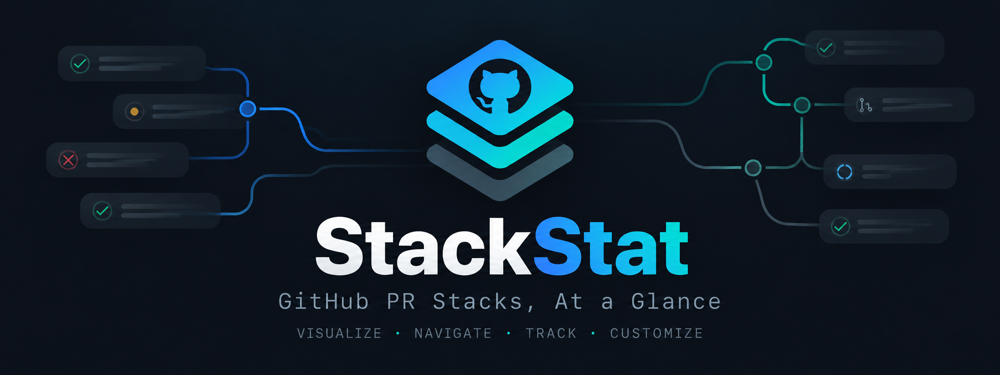
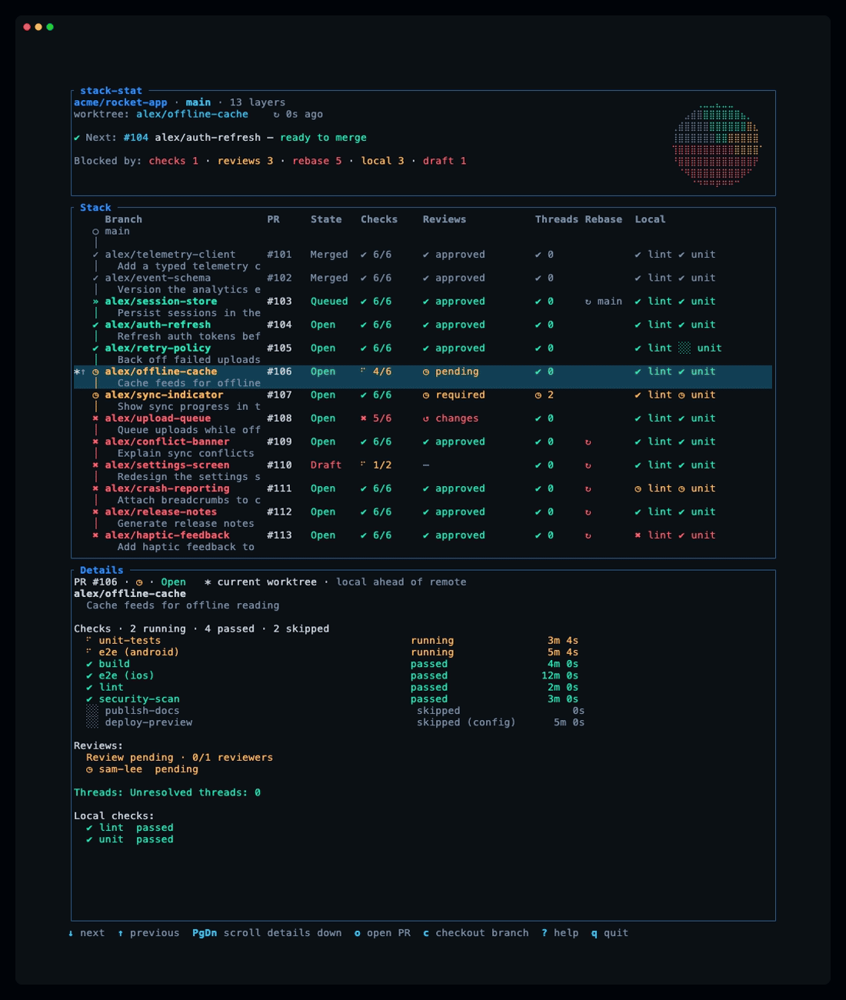

<p align="center">
  
</p>

<p align="center">
  <a href="https://www.rust-lang.org"></a>
  <a href="https://ratatui.rs"></a>
  <a href="https://github.com/cam1se/stack-stat/releases"></a>
  <a href="https://github.com/cam1se/stack-stat"></a>
</p>

# stack-stat

See every layer of the stack containing your worktree's checked-out branch, or follow that branch on its own before or after opening a PR. Know at a glance whether each PR is ready to merge and, if not, what is blocking it. The header always identifies the actual worktree branch, even when an agent switches branches while the dashboard is open.

Open PRs carry verdict glyphs: `✔` ready, `◷` waiting on CI, a review, or a local result, and `✖` blocked. Merged, queued, and closed PRs use separate lifecycle glyphs. The header names the next PR to merge with a bullet per issue, and the always-open detail pane lists failing checks first. A branch with no PR still shows local checks, but is not a ready-to-merge PR. Here is a short tour:

<p align="center">
  
</p>

## Setup

Install Git and an authenticated [GitHub CLI](https://cli.github.com/):

```sh
gh auth login
```

From a Git repository, run `stack-stat`. The tool follows **the current worktree branch** without needing local stack tracking:

- If its selected PR belongs to a GitHub stack, show that stack in GitHub's layer order, with the stack's base branch as trunk. A real stack with one entry still uses stacked mode.
- If the PR has no GitHub stack, show it as a single entry, with its PR base branch as trunk. CI, reviews, draft state, and remote rebase checks work just as they do for a stacked PR.
- If no matching PR exists, show one row for the current branch, with the repository's default branch as trunk. PR-only cells remain empty and a `no PR yet` hint explains the absence; [local checks](local-checks.md) still show current, failed, stale, or missing results. This row is not a merge-ready PR.
- If the newest PR for the branch was closed without merging, show it as closed history: never ready to merge and never the next PR to merge.

The default branch itself, without a PR, shows "Default branch" and asks you to check out a feature branch. A detached or empty HEAD shows "No attached branch" and asks you to check out a branch. Startup requires GitHub CLI and authentication, not the stack extension.

Install [gh stack](https://github.com/github/gh-stack) only to use **stacked** checkout, push, or sync: `gh extension install github/gh-stack`. These actions ask for confirmation. If stacked push or sync finds no local tracking, a further prompt asks to link the stack through `gh stack checkout` before continuing; declining leaves it unchanged. In single mode, push instead runs plain `git push`, while checkout and sync are disabled with a status message. Opening a PR and toggling draft/ready state need no extension and work for a single PR; without a PR, those actions are unavailable.

At launch, an animated wordmark and indeterminate loading indicator wait for the first GitHub result before revealing the dashboard. Press any key to skip it; `q` and Ctrl-C still quit immediately.

## Install and update

After a stable release is published, macOS/Linux users can run the checksum-verifying installer:

```sh
bash <(gh api repos/cam1se/stack-stat/contents/scripts/install.sh -H 'Accept: application/vnd.github.raw')
```

Windows users can run [install.ps1](https://github.com/cam1se/stack-stat/blob/main/scripts/install.ps1) in PowerShell. `STACK_STAT_VERSION=vX.Y.Z` pins a stable release; `INSTALL_DIR` changes the destination. Both installers verify `checksums.sha256` before installing.

`stack-stat version` prints the version and target triple. `stack-stat update` checks GitHub Releases for a newer stable binary, verifies its checksum, and replaces the installed executable. It does not update on its own; the TUI only displays an availability notice. Until the first release exists, `update` exits with `no stable release found`.

## Read the dashboard

- **Header:** repository, trunk, and stacked or single mode; the checked-out worktree branch and age of the last GitHub refresh; and, on larger terminals, a pie chart of row statuses beside two lines: `Next to merge:` names the lowest open PR layer by its PR title, or its branch name when the title is empty (stacks merge bottom-up), followed by one bullet per issue, colored red when it blocks and yellow when it is only waiting (or `ready to merge`), and `Blocked by:` counts rows by issue category, including issues that are waiting rather than blocking. A no-PR row is never selected as the next PR to merge. On smaller terminals the header shows nonzero counts for each verdict, including merged, queued, and closed PRs (`⊘`). A spinner means data is being fetched; an overdue refresh is highlighted.
- **Table:** rows hang off the trunk on a git-tree style spine; each PR layer is two lines with its colored verdict glyph as the node. The first line leads with the PR title in bold, then the PR number, state (draft is a PR flag layered over open, alongside merged, queued, and closed), checks, reviews, and local reports; the branch name sits dimmed on the second line. A no-PR row keeps the branch as its headline with a dimmed `no PR yet` hint, without inventing PR cells or a ready-to-merge verdict. The animated, pulsing row is the selected branch shown in the detail pane; `*` in the left column marks the branch checked out in this worktree. A muted suffix reports only that branch's local sync: `↑` has unpushed commits, `↓` has remote commits to incorporate, `⇅` has diverged, and `?` has no remote-tracking branch. Local sync does not change readiness or verdict colors. For a PR, the verdict glyph and headline color answer "is this ready?": `✔` means ready, not a draft, CI passing, no changes requested or review outstanding, no rebase needed, and declared local checks have no failed, stale, or missing result; `◷` means nothing is blocking but evidence is outstanding (running CI, pending review, missing local result); `✖` means a draft, failed CI, requested changes, rebase needed, or a failed or stale local result. Merged and closed layers are dimmed in every column; queued layers are green, and a draft state is red. The Checks cell shows `✔` (green) when everything passed and `✖` (red) when something failed; while any check is queued or running, an animated spinner replaces that icon and keeps the color of the worst state, so it spins yellow normally and red when something has already failed, and the icon returns when the checks finish. It gives passed/total for checks that ran, excluding those skipped by the workflow or by [repository configuration](configuration.md). `—` means no result. The Threads column counts unresolved review threads: green `✔ 0` when all are resolved, yellow `◷ N` when some are open, red `✖ N` when open threads are configured to block (see [configuration](configuration.md)). The Rebase column appears only when a PR layer needs a rebase: a red `↻` means the layer is blocked because it, or a layer under it, must be rebased (the detail pane names which; a rebase moves every layer above it, so each of them is marked), and `↻ <trunk>`, for example `↻ main`, means the first unmerged layer is behind the trunk (gray unless `rebase.onto_trunk` makes it blocking). The Local column appears only when local checks are declared or reported for the view. The Reviews cell is red for changes requested, yellow when GitHub requires a review that is still outstanding (`required` when nobody has been asked, `pending` when someone has), and green when approved; when reviews are not required it stays gray and does not block the ready verdict.
- **Detail pane:** always open for the selected branch and starts on the worktree's checked-out branch. Its header names that branch's local sync next to `current worktree`, then shows the PR title in bold with the branch name dimmed beneath it (a branch without a PR title keeps the branch name as the headline); checks are listed failing first, then running, passed, and skipped, with durations; reviews show a headline and each visible reviewer, then local reports and whether the branch needs a rebase. When the details are longer than the pane, a scrollbar on its right edge shows the position; scroll with Page Up/Down or the mouse wheel.
- **Footer:** key hints and operation results. Actions that change GitHub or the worktree prompt for `y`; opening a PR in the browser runs immediately.

| Key or mouse gesture | Effect |
|---|---|
| ↑/↓, Home/End | Select next/previous or first/last row |
| Page Down/Up | Scroll the detail pane by page; branch selection stays put |
| Wheel over table / detail | Move selected branch / scroll detail lines |
| Click a table row | Select that branch |
| `o` | Open the selected PR in a browser; unavailable without a PR |
| `c` | Confirm stacked checkout; disabled in single mode |
| `p` | Confirm push: `gh stack push` in stacked mode, plain `git push` in single mode |
| `S` | Confirm stacked sync; disabled in single mode |
| `m` | Confirm draft/ready toggle; unavailable without a PR |
| `R` | Refresh all data sources |
| `/`, `s`, `b` | Filter branches, cycle sort order, show/hide bot reviews |
| `?`, `q`, Ctrl-C | Help, quit |

The in-app `?` overlay is the source of truth for keybindings. In filter mode, type a branch substring, press Enter to keep it, or Esc to clear it. `s` cycles stack order, ascending PR number, and worst-check-first status order. Git and local results refresh frequently; GitHub refreshes more often while CI is active. Network failures preserve the last successful GitHub data.

Agents, hooks, and scripts can report commit-specific [local checks](local-checks.md). See [configuration](configuration.md) for CI filters, reviewer preferences, and polling, or [troubleshooting](troubleshooting.md) for error states.
